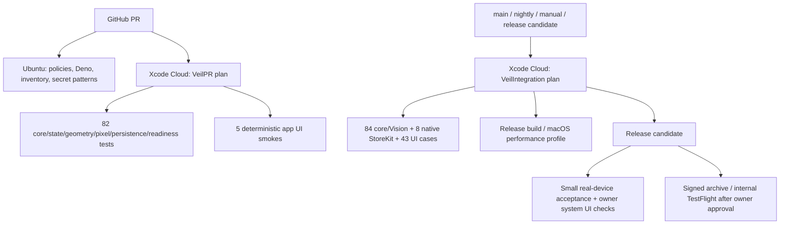

> Focused advertising addition 2026-10-27: seven deterministic core cases add to the unchanged layers: PR94 (89core+5UI), Integration142 (89core+2Vision+8StoreKit+43UI), Commerce23 unchanged. Historical counts below retain their prior revision scope.

# Veil testing and release strategy

## Current internal-beta evidence — 2026-11-15

Inventory contains163 Swift methods:102 PR Gate entries (95 core +7 UI),60
Integration-specific entries and1 Real Device entry; plan memberships overlap.
VeilCommerce selects31 cases (16 core,8 hosted StoreKit,7 UI). One new retained
Integration method captures actual dark application appearance alongside the light
Editorial journey. Run these capture methods in separate invocations after setting
`simctl ui <destination> appearance light` / `dark`; a launch argument alone did
not change native appearance on this host. Verify actual screenshots and restore
Light after this local capture workflow (the preboot appearance getter returned
unknown). See [current beta evidence](../QA/NextRelease/Beta/STATUS.md) and the historical
[visual review evidence](../QA/NextRelease/FinalReview/STATUS.md).
Historical counts below refer to their original revisions, not current totals.

## Architecture

Until owner activates and requires Xcode Cloud, the same plans execute on GitHub's **macos-26 Apple Silicon** runner. `APPLE_CI_PROVIDER=xcode-cloud` disables that fallback only after a verified transition; backend/security checks stay on GitHub. No Apple test results are replaced by a no-op success.

## Coverage and boundaries

[TEST_MATRIX.md](TEST_MATRIX.md) and its machine-readable inventory assign every test a home. Baseline: 50 SwiftPM core methods (48 deterministic, two opt-in macOS Vision/performance profiles); release preparation adds fifteen deterministic readiness methods (including nine source-metadata/choice regressions), 35 legacy UI methods. Added: five deterministic UI smokes, two native real-Vision integration tests, one physical-device acceptance method. No legacy test is removed, skipped or silently quarantined. `verify_execution.py` compares native executed identifiers to the inventory and requires every case to pass on every destination/configuration; zero-test, missing-test, skipped or expected-failure green runs are rejected by both runners.

Current audited inventory (2026-10-13): PR **87 tests** (82 core + five UI). Integration **135 iOS tests** (82 core, two real Vision, eight native StoreKit, 43 UI), plus the two opt-in macOS performance methods. Commerce **23 tests** overlaps these layers. Device: one focused real-Vision/composition/save/reopen flow. Integration repeats deterministic core protection deliberately; these counts overlap.

Watermarking adds nine deterministic core rendering/geometry/limits/persistence cases, one PR composition/scoped-Undo/privacy-focus case, and two native Integration UI workflows. Existing layers and all baseline methods remain; no provider/test architecture changes.

Only external analysis is substitutable: `PrivacyAnalyzing` returns the existing face/plate/document geometry and foreground mask. Production always uses `VisionPrivacyAnalyzer`. A DEBUG-only fixture analyzer requires **both** explicit test launch flags. The same selection/cache lifecycle, scoped Undo, effects, masks, shared renderer, asynchronous publication and persistence execute afterward. Small PR fixture input is 600 pixels; full-resolution render/export semantics are covered by native pixel tests and full integration. Release validation checks fixture implementation/resources are absent. No alternative application behavior or fake authentication is introduced.

Core tests exercise high-volume cancellation and automatic history without expensive UI loops. The PR UI cases protect native interaction, scoped clear/reactivation, independent mixed-effect layers, Documents details/whole coverage, pending/zero distinction, Undo, Done, export parity, actual local save/relaunch/reopen/deletion, and toolbar geometry. Existing comprehensive tests continue using real Vision and system services in Integration.

## Execution, isolation and synchronization

Run `scripts/ci/run_apple.sh VeilPR` or `VeilIntegration`. One build-for-testing precedes test-without-building; no repeated `xcodebuild test` rebuild per test. The default evidence directory is unique per run; set `VEIL_CI_OUTPUT` to a fresh directory to choose its location. Set `VEIL_DERIVED_DATA` to reuse already-built products across sequential local plans. Never run two independent UI xcodebuild sessions on the same local host for timing measurements; use Xcode-managed workers within one invocation. Set `VEIL_DESTINATION` for a different installed destination. The shared scheme exposes all three plans. Xcode Cloud owns its native build/test scheduling; its hooks do not recursively launch builds.

The PR plan runs serially: Core Image unit tests and app UI must not compete for the same hosted virtual GPU. Integration now runs serially too: hosted native StoreKit and system UI are isolated after the recorded commercial1.0 mixed-run failure (ADR008). Its filesystem stores still use unique temporary directories. PR UI history uses a UUID namespace per test and survives only that test's intentional relaunch. PR UI is serial within its class. Legacy UI remains serial: it shares fixture history/system permissions and must not be sharded until that mutable state is isolated. Device acceptance also has its own history namespace.

Wait on actual application state: detection region availability or completed analysis state, then `processingComplete` and its nonempty rendered fingerprint. A pending detector must never be interpreted as a completed empty result. `analysisCounts` verifies cached re-entry; `privacySelectionCounts` verifies independence; pixel assertions verify the renderer rather than only selected buttons. All five PR smokes share one monotonic deadline per case, supplied by the plan and validated against its unchanged 180-second runaway ceiling. Launch, every state wait and every assertion consume that same budget; there is no multiplied per-step allowance and no cold-GPU operation performance assertion. Correctness is synchronized to completed rendered state. No arbitrary sleeps for application synchronization. Provider status polling is bounded external job polling, not app synchronization.

## Flakiness and failure policy

A flaky test yields different outcomes against unchanged code/fixtures/toolchain without a demonstrated product-state difference. Do not assume a timeout is infrastructure: inspect analysis state, render identity, test logs and screenshots first. A deterministic wrong state/pixel result blocks merge wherever it is discovered.

PR checks must be deterministic, isolated and normally finish in minutes. Integration and device jobs retain real-world nondeterminism and report honest red status. Moving expensive coverage to Integration is not waiving a release requirement. No automatic retry is configured. A single diagnostic rerun is permitted only after identifying infrastructure failure and recording the initial evidence; never repeatedly rerun until green. Never retry a deterministic assertion to conceal a bug.

Per-test execution ceilings (180 s PR, 600 s Integration, 300 s device) terminate runaway cases; they do not change app readiness assertions. Job budgets: PR 20 min, Integration 120 min, opt-in device 40 min. The larger Integration budget accommodates the retained comprehensive suite; the PR fix is architectural separation, not a larger timeout. The old Documents readiness wait remains scoped to actual analysis. Any future adjustment requires measured timing and justification.

No tests are currently quarantined. A future quarantine must be a reviewed inventory change with issue, owner, exact guarantee duplicated by deterministic coverage where possible, evidence, expiry (maximum 14 days), and restoration criteria. It stays visible and red/nonblocking in Integration; never mark a skipped release requirement passed.

## Diagnostics and privacy

Pipeline log labels distinguish setup/compilation from plan execution. `.xcresult` is authoritative; exported JSON includes failing identity, durations, messages and test hierarchy. `failure-context.json` labels the affected layer conservatively; a UI timeout is not automatically classified as infrastructure. Failure attachments include native screenshots/logs. Save native build/test logs, toolchain version, result summary, timings and relevant app analysis state. Identify the failing layer: core/rendering, Vision, app UI, OS integration, backend/security or infrastructure. GitHub logs/JSON expire after seven days for PR and 14 days for Integration. Full native bundles/screenshots are uploaded on failure/cancellation; manual Integration can set `keep_full_results=true` for successful release-candidate evidence. Passing nightly runs retain timings and test identities without accumulating hundreds of megabytes of image artifacts. Xcode Cloud's native evidence retention follows Apple's service policy (currently 30 days). Use approved fixtures only; never personal photos, OCR payloads, tokens or signed private cloud URLs in diagnostics.

## Merge and release gates

Merge requires the active Apple PR check, repository-security and backend-policy-and-deletion-tests, plus sufficient full integration evidence for V4. A known product failure prevents merge even if outside PR. Integration failures must be triaged explicitly; system/provider timing failures are not silently reclassified as product success.

A release candidate requires **green full Integration and Release build on the exact candidate SHA**, the two opt-in macOS profiles, completed real-device acceptance (owner iPhone is valid until provider pilot), and owner review of PhotosPicker, add-only Photos permission/save and Share extensions. A previous SHA's green run is not release validation. Record evidence in a release QA report. Xcode Cloud archive/TestFlight is a separate owner-controlled workflow; no store submission or automatic production deployment is added.

Sources: [Apple test organization](https://developer.apple.com/documentation/xcode/organizing-tests-to-improve-feedback), [Apple parallel testing](https://developer.apple.com/videos/play/wwdc2024/10195/), [Apple workflow actions](https://developer.apple.com/documentation/xcode/configuring-your-xcode-cloud-workflow-s-actions).

## Native commerce layer — 2026-10-12

Ten deterministic commerce tests extend the existing unhosted core PR gate (87 PR cases total). Eight actual Apple local StoreKit integration cases live in the separate app-hosted `PhotoVeilCommerceTests` target; app hosting supplies StoreKit's application purchase context without changing the unhosted geometry/state/pixel architecture. Five commerce UI cases (including a real local trial → unlimited exports → app restart flow) exercise the same editor/gallery output paths and isolated Keychain usage. `VeilCommerce` selects those 23 cases; the full Integration plan retains all prior cases and adds hosted commerce. Local scheme StoreKit configuration is explicit; it is not a production app resource. Successful SKTestSession setup and local product availability are prerequisites, never a fallback to live App Store authentication. The invalid initial unhosted StoreKit attempt is documented in ADR-007. No paid service or CI provider activation.

Local StoreKit QA currently uses a dedicated iOS 26.1 simulator with Xcode 26.6 CLI: installed iOS 26.5 (23F77) rejects native configuration writes (Code3). Do not count failed setup as passing lifecycle coverage or authenticate a production Apple Account. Native tests check exact fixture IDs before purchase, verify `.xcode` transactions, and use documented reset rather than the nil simulated-error override rejected by this runtime. Mutation assertions await signed native updates, with no sleeps or retries. Native automatic grace exhaustion uses Apple’s `.oneRenewalEveryTwoSeconds` test clock with registered event observers and the existing ten-second bound; signed expiration and access loss are asserted. Billing recovery is not claimed.

## Commercial 1.0 candidate — 2026-10-13

The Apple runner now accepts VeilCommerce and retains normal simulator ad-hoc signing, required for the quota Keychain. StoreKit-containing default destinations select installed iOS 26.1 deterministically and fail clearly if absent; explicit VEIL_DESTINATION remains supported. PR keeps newer-runtime coverage. No CI provider was activated. A real native App Store capture journey adds one Integration case; source sample metadata is explicitly fictional, generated locally, and excluded from Release alongside all fixtures. Marketing version is 1.0, local build 5 pending App Store Connect build-number confirmation. Current evidence is recorded in Documentation/AppStore/FINAL_QA_REPORT.md, not inferred from historical runs.

Commercial1.0 candidate isolation amendment (2026-10-13, ADR008): run VeilIntegration serially as well as PR/Commerce. The mixed full135 run produced133passes and two hosted StoreKit failures (missed native accelerated grace transitions and XCTest stall). Diagnostics do not prove GPU contention or a production deadlock. Preserve original failure evidence, unchanged native tests/timeouts and all135 cases. Serial Commerce comparison is targeted evidence only; complete serial Integration is still required. This trades local wall time for StoreKit/system-UI isolation; it does not activate CI or a provider.

## Next-release automatic-region coverage — 2026-11-14

One deterministic PR UI workflow extends `VeilPRSmokeTests` in the existing plan:
face/plate/document move and resize, second-region independence, preserved tap
selection, scoped Undo, separate document coverage/cache, zoom and adjusted
Save-to-Veil export fingerprint parity. It uses the existing substituted external
analysis boundary and the real editor/canvas/renderer/export/persistence; it is
not new Vision accuracy evidence. Current inventory: PR95 (89 core + six UI).
No test layer, provider, timeout or retry policy changes. Physical VoiceOver,
two-finger gesture feel, detector recall and full-release integration remain
separate acceptance requirements.

## Premium preview refinement — 2026-11-14

Current PR plan: **100 cases** (93 core + seven deterministic UI). Commerce:
**27 cases** (14 quota/presentation core + eight native StoreKit + five UI).
Four core cases cover actual-limit state, verified Pro/unknown access, invalidated
scan epochs and read-only/dirty usage. The added PR workflow consumes real successful
local saves, then verifies marks across tools/effects, Undo, original comparison,
Done, zoom/pan, foreground and relaunch. Existing Commerce cases additionally assert
native restore/expiry/revocation preview state and purchase removal of marks.
A single Integration photographic journey captures real Vision, manual redaction,
metadata choice, saved clean gallery and exhausted light/dark previews; it does not
substitute detector, quota or Pro state. Marketing fixtures are Debug-only resources
with Release exclusions and the existing Release bundle guard. No new test layer,
provider, timeout or retry policy. Counts overlap; full release Integration remains.
